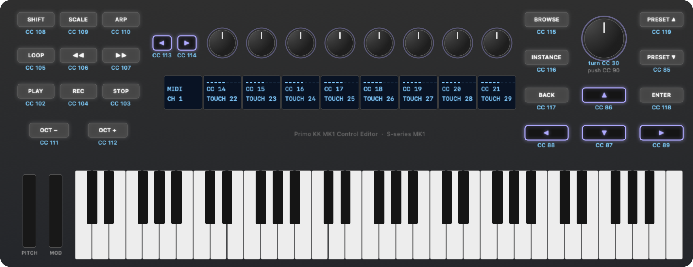
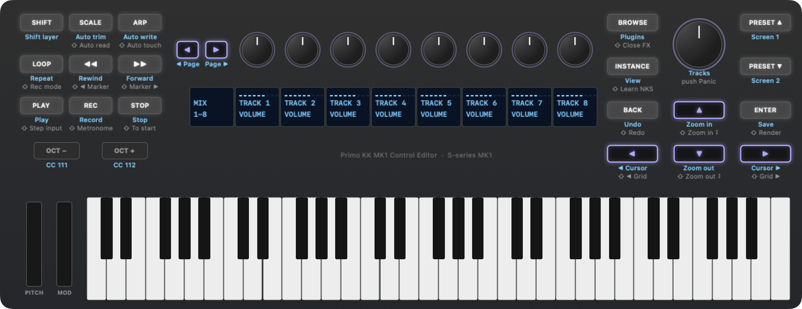
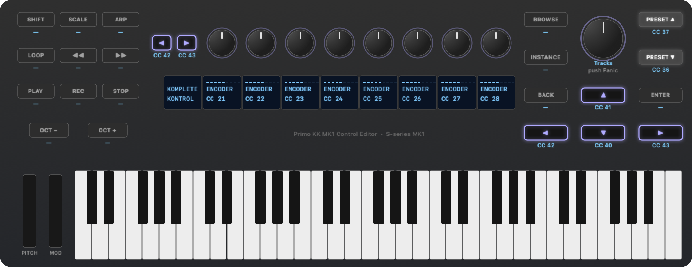

# PrimoKKMK1Bridge user guide

PrimoKKMK1Bridge makes a Native Instruments **Komplete Kontrol S-series MK1** keyboard (S25, S49, S61, S88) fully
usable on macOS without Native Instruments' software:
- every button, knob and touch sends MIDI on a virtual port, **Primo Komplete Kontrol MK1**
- the button lights and the nine displays are driven
- an optional REAPER mode turns the keyboard into a REAPER control surface

It comes as two programs:

- **The bridge** (PrimoKKMK1Bridge) talks to the keyboard and does the work. It runs in the background.
- **The editor** (Primo KK MK1 Control Editor) is a Mac app for changing what every control does. It starts and
  stops the bridge.

**Contents**

1. [What you need](#what-you-need)
2. [Install](#install)
3. [Getting started](#getting-started)
4. [Start the bridge at login](#start-the-bridge-at-login)
5. [The editor](#the-editor)
6. [MIDI mode](#midi-mode)
7. [REAPER mode](#reaper-mode): [buttons](#buttons-in-every-view), [Mix view](#mix-view),
   [Track view](#track-view), [Komplete Kontrol view](#komplete-kontrol-view),
   [track colour on the keys](#track-colour-on-the-keys)
8. [Default assignments](#default-assignments)
9. [Lights and displays](#lights-and-displays)
10. [The config file](#the-config-file)
11. [Troubleshooting](#troubleshooting)
12. [The keyboard without the bridge](#the-keyboard-without-the-bridge)

## What you need

- A Komplete Kontrol S-series MK1 keyboard. Tested on an S61 MK1, firmware 72. The S25, S49 and S88 should work
  but haven't been tried.
- A Mac with macOS 14 or later. The release download is for Apple Silicon. On an Intel Mac,
  [build it from source](../README.md#build-and-run).
- For REAPER mode: REAPER (tested with 7.61).

## Install

1. Download `PrimoKKMK1Editor-<version>-macOS-arm64.zip` from the
   [releases page](https://github.com/gsenger3/PrimoKKMK1Bridge/releases) and unzip it.
2. **Move PrimoKKMK1Editor.app to your Applications folder.** That's the recommended place: starting the bridge at
   login uses the app where it is. The bridge is inside the app, so there's nothing else to install.
3. The app is signed for local use only, not notarized by Apple, so macOS blocks it the first time. Either open
   it once and click **Open Anyway** in System Settings ▸ Privacy & Security, or run this in Terminal:
   ```bash
   xattr -dr com.apple.quarantine /Applications/PrimoKKMK1Editor.app
   ```
   Use the `xattr` command if you'll [start the bridge at login](#start-the-bridge-at-login): it clears the bridge
   inside the app too.

To build it yourself instead, see [Build and run](../README.md#build-and-run).

## Getting started

1. Plug in the keyboard and open **Primo KK MK1 Control Editor**.
2. Turn on the **bridge switch** in the toolbar. The light next to it turns green, the keyboard's buttons light
   up, and the displays wake up.
3. In your DAW, use the MIDI input **Primo Komplete Kontrol MK1**. It carries the keys, the pitch and mod strips
   and every control, so one input is all a track needs.

Good to know:

- **Don't give a track both ports.** The keyboard's own port, *KOMPLETE KONTROL S61 Port 1*, still sends the keys
  too, so never give a track that and Primo Komplete Kontrol MK1, or *All MIDI inputs*: every note would arrive
  twice.
- **The bridge keeps running when you quit the editor.** Turn the switch off to stop it.
- **After the bridge stops,** the keyboard stays in *native mode*, with silent knobs, until you unplug and replug
  it or start the bridge again.
- **The config file** is created the first time you run the editor or the bridge, with every default:
  `~/Library/Application Support/PrimoStudios/PrimoKKMK1Bridge/PrimoKKMK1Bridge.json`. A new config starts in
  [MIDI mode](#midi-mode). For REAPER, turn on **Enabled** under **REAPER Mode** on the editor's Settings page.

## Start the bridge at login

To have the bridge start when you log in, without the editor, turn on **Launch Bridge at Login** under **Login** on
the editor's Settings page. It applies right away, without saving, and starts the copy of the bridge inside the app
where the app is now, so move the app to your Applications folder first. It takes effect at your next login; to
start the bridge now too, use the bridge switch.

How it behaves:

- **After a crash,** it's started again.
- **With the editor's switch,** you can still turn it off. That's a normal quit, so it stays off until your next
  login, and the switch can turn it back on.
- **Its output** goes to `~/Library/Logs/PrimoKKMK1Bridge.log`, the same log the editor's **Show Log** opens.
- **If you move the app,** the Settings page shows the copy it starts, with **Use This App** to switch to the one
  you're running.
- **Turning it off** stops it starting at your next login. A bridge it already started keeps going until you turn
  it off with the switch or log out.

Under the hood it's a *LaunchAgent*, `~/Library/LaunchAgents/com.primostudios.PrimoKKMK1Bridge.plist`.

<details>
<summary>Setting it up by hand instead</summary>

For the app in the Applications folder, paste these into Terminal; the first one is long:

```bash
mkdir -p ~/Library/LaunchAgents ~/Library/Logs && cat > ~/Library/LaunchAgents/com.primostudios.PrimoKKMK1Bridge.plist <<EOF
<?xml version="1.0" encoding="UTF-8"?>
<!DOCTYPE plist PUBLIC "-//Apple//DTD PLIST 1.0//EN" "http://www.apple.com/DTDs/PropertyList-1.0.dtd">
<plist version="1.0">
<dict>
    <key>Label</key><string>com.primostudios.PrimoKKMK1Bridge</string>
    <key>ProgramArguments</key>
    <array><string>/Applications/PrimoKKMK1Editor.app/Contents/MacOS/PrimoKKMK1Bridge</string></array>
    <key>RunAtLoad</key><true/>
    <key>KeepAlive</key><dict><key>SuccessfulExit</key><false/></dict>
    <key>ProcessType</key><string>Interactive</string>
    <key>StandardOutPath</key><string>$HOME/Library/Logs/PrimoKKMK1Bridge.log</string>
    <key>StandardErrorPath</key><string>$HOME/Library/Logs/PrimoKKMK1Bridge.log</string>
</dict>
</plist>
EOF
```

```bash
launchctl bootstrap gui/$(id -u) ~/Library/LaunchAgents/com.primostudios.PrimoKKMK1Bridge.plist
```

That also starts the bridge right away. To undo it:

```bash
launchctl bootout gui/$(id -u)/com.primostudios.PrimoKKMK1Bridge; rm ~/Library/LaunchAgents/com.primostudios.PrimoKKMK1Bridge.plist
```

</details>

## The editor

The editor shows a drawing of the keyboard. **Click a button, knob or strip**, and the panel on the right shows
what it does and lets you change it. Each control on the drawing is labelled with its current assignment, and a
second line starting with ⇧ shows what it does with Shift held.

The pages, chosen in the toolbar, follow the mode you're in:

| Mode | Pages |
| --- | --- |
| MIDI mode | **MIDI**: the CC each control sends · **Settings** |
| REAPER mode | **REAPER**: the command each button runs, alone and with Shift · **Komplete Kontrol**: that view's CCs · **Settings** |

**Settings** has these sections. REAPER Views, Reaper Lightguide and Komplete Kontrol View appear only while REAPER
mode is on.

| Section | What's in it |
| --- | --- |
| **MIDI Configuration** | The bridge's **Port name** and **Channel**, and the Shift layer: **Shift Layer Enabled** and **Shift Layer Channel** |
| **MIDI Keys & Controls** | **Merge Keys and Controls**: whether the keys and strips also come through the bridge's port. **Automatic (Port 1)** takes them from the keyboard's own port, **From MIDI Source by Name** from the source you name, and **Disabled** leaves them on the keyboard's port only |
| **Lights and Displays** | **Enabled** drives the button lights, at **Active Brightness** when lit and **Idle Brightness** otherwise. **Enable Displays** drives the nine displays |
| **REAPER Mode** | **Enabled** turns REAPER mode on. **Address**, **Local Listen Port** and **Device Port** match REAPER's OSC device ([Set up REAPER](#set-up-reaper-once)) |
| **REAPER Views** | **Default View**: the view the bridge starts in. **Follow REAPER Track Selection**: the keyboard follows the track you click in REAPER. **Select Active Keyboard Track in REAPER (Track and Komplete Kontrol Views)**: in those views, the track you pick on the keyboard becomes REAPER's selected track. **Track Name Display Duration**: how long the displays show the track's name after you change track. **REAPER Resource Folder**: where the screenset names come from |
| **Reaper Lightguide** | The selected track's colour on the keys, and the REAPER script it needs: see [Track colour on the keys](#track-colour-on-the-keys) |
| **Komplete Kontrol View** | That view's **MIDI Channel** and **Knob Values** mode |
| **Login** | **Launch Bridge at Login**: start the bridge when you log in, without the editor. It applies right away, without saving. See [Start the bridge at login](#start-the-bridge-at-login) |
| **Logging** | **Verbose Logging**: the bridge writes every message it sends to its log, for tracking down a problem. Turn it off again afterwards, as the log grows quickly. **Show Log** opens the log |

**Reset to Default Settings…**, at the bottom, puts every setting and assignment back to its default, apart from
REAPER mode. Nothing is written until you save.

Other things in the editor:
- **Saving:** **Save** (⌘S) writes the config file, and a running bridge picks it up within a second or two.
  **Revert** throws away unsaved edits. If a change can't work, the status bar says why and Save stays off.
- **The bridge switch** shows whether the bridge is running, however it was started, and starts or stops it. The
  same commands are in the **Bridge** menu, with **Show Bridge Log** and **Show REAPER Track Colour Script**.
- **File ▸ Open Config…** edits another config file for the session. Normally you don't need it.
- **Help ▸ Primo KK MK1 Control Editor Help** opens this guide.

## MIDI mode

MIDI mode is the default. Every control sends a MIDI CC on **Primo Komplete Kontrol MK1**, channel 1, for MIDI
learn in any DAW. Buttons send 127 when pressed and 0 when released; knobs send absolute values (0–127).

**Shift layer.** Holding Shift moves the buttons, knob turns and the Navigate knob turn to **channel 2**, so every
control has a second assignment with the same CC numbers.
- Shift itself sends CC108 on channel 1.
- Knob touch and Navigate touch always use channel 1.
- A release goes out on the channel of its press, even if you let go of Shift first.

**Lights from the DAW.** The bridge also has a MIDI *output* called Primo Komplete Kontrol MK1. A CC sent there:
- lights its button (any value above 0) or dims it (0)
- on channel 2, sets the light shown while Shift is held
- for a knob, moves that knob's value, so it carries on from the DAW's value instead of jumping

The keys, pitch strip (pitch bend) and mod strip (CC1) work as always, and Octave − / + transpose the keys on the
keyboard as well as sending their CCs. The CC of every control is in [Default assignments](#midi-mode-defaults).

## REAPER mode

In REAPER mode the bridge talks to REAPER over OSC, REAPER's own control-surface protocol. The transport and
editing buttons run REAPER commands, and the knobs work in three **views**. **Instance** steps through them:
**Mix → Track → Komplete Kontrol → Mix**. The Instance light shows which view you're in: off in Mix, medium in
Track, full in Komplete Kontrol.

### Set up REAPER (once)

1. **Turn on REAPER mode:** on the editor's Settings page, turn on **Enabled** under **REAPER Mode**, and save.
2. In REAPER, go to **Preferences ▸ Control/OSC/web ▸ Add**, and choose Control surface mode **OSC (Open Sound
   Control)**:
   - Device name: `PrimoKKMK1Bridge`, Pattern config: **Default**
   - Mode: **Configure device IP + local port**
   - Device port `9000`, Device IP `127.0.0.1`, Local listen port `8000`. These match **Device Port**,
     **Address** and **Local Listen Port** under **REAPER Mode** on the editor's Settings page.
3. **Preferences ▸ MIDI Devices:** enable **Primo Komplete Kontrol MK1** for input.
4. **Komplete Kontrol track:** set its MIDI input to **Primo Komplete Kontrol MK1**. It carries the keys, the strips
   and the Komplete Kontrol view's CCs. For tracks that should only get the keys, use the keyboard's own *Port 1*,
   so the bridge's CCs aren't recorded into their items.
5. **Optional:** to have the keys play whichever track you select, right-click a track's record-arm button and turn
   on **Automatic record-arm when track selected**.

Until REAPER answers, the displays read *waiting for OSC from REAPER* (and with the
[track colour script](#track-colour-on-the-keys) installed, the keys are purple).

When the bridge starts, it runs REAPER's *Control surface: Refresh all surfaces* action to get the whole project,
since REAPER otherwise only sends values that changed. Your other control surfaces (MCU, FaderPort, HUI) are
refreshed at the same moment.

### Buttons in every view

The buttons do the same in all three views, apart from the Komplete Kontrol view's own CCs.
- **Shift:** a combination without a command of its own sends that button's CC on channel 2, as in MIDI mode.
- **Navigate knob:** turning it picks the previous or next track. In Mix view it also switches to
  [Track view](#track-view), so the knobs and displays show the track you pick. The Komplete Kontrol view stays as it
  is, so you can move between instrument tracks and keep their plugins on the knobs.
- **Changing track:** the displays show *TRK* with the track's number and name for 2 seconds (**Track Name Display
  Duration** in Settings), then the knob values.
  Touching a knob ends that early.
- **Clicking a track in REAPER** selects it on the keyboard too.

The full list of what each button does, alone and with Shift, is in [REAPER mode defaults](#reaper-mode-defaults).
One of them needs a note: REAPER doesn't report the record mode over OSC, so Shift + Loop (normal ↔ time-selection
auto-punch) follows the last mode set from the keyboard. If you change the mode in REAPER, one extra press brings
them back in step.

### Mix view

The default view. The 8 knobs are the volumes of 8 tracks, and with Shift held, their pans.

| Control | Does |
| --- | --- |
| Knobs 1–8 | Volume of the 8 tracks on the knobs |
| Shift + knob | Pan of that track |
| Knob touch | Frames that knob's bar, and tells REAPER the fader (with Shift held, the pan) is touched, for *Touch* automation |
| Page ◀ / ▶ | Previous / next 8 tracks |

The left display shows *MIX* and the tracks on the knobs, such as *9-16*. Each knob's display shows the track's name,
its volume and a bar. While Shift is held, the left display shows *PAN*, and each knob's display shows the track's
pan (*CENTER* at the centre) with a bar from the middle. Knobs past the last track stay blank, and the master track
isn't on the knobs. To reset a volume to 0 dB, select the track and use Shift + knob 1 in [Track view](#track-view).

### Track view

The knobs control the selected track. A track you pick with the Navigate knob also becomes REAPER's only selected
track, and REAPER scrolls to it.

| Knob | Page 1 | Shift + turn |
| --- | --- | --- |
| 1 | Volume | Reset to 0 dB |
| 2 | Pan (the display reads *CENTER* at centre) | Snap to centre |
| 3 | Mute: turn right for on, left for off | CC16, channel 2 |
| 4 | Solo: right on, left off | CC17, channel 2 |
| 5 | Record arm: right on, left off | Record monitoring: right on, left off |
| 6–8 | Sends 1–3 | CC19–21, channel 2 |

**Page ▶** shows the next 8 sends (page 2: sends 4–11, page 3: sends 12–16), and **Page ◀** goes back. Only sends
that are routed somewhere appear, in order, each with the track it feeds and its level.

The left display shows the track's name and *TRK n*, or the page, such as *PAGE 2/2*. The record-arm display also
shows the monitoring (*ON MON*, *off AUTO*); while Shift is held it shows *MONITOR*.

### Komplete Kontrol view

The knobs and eight navigation buttons send fixed CCs for Komplete Kontrol's NKS MIDI template, like Novation's
Launchkey keyboards do. They go out on Primo Komplete Kontrol MK1, channel 1. The other buttons keep their REAPER
jobs. Turning the Navigate knob picks the previous or next track and keeps you in this view; the track you pick also
becomes REAPER's only selected track, and REAPER scrolls to it.

| Control | CC | Does in Komplete Kontrol |
| --- | --- | --- |
| Knobs 1–8 | 21–28 | The 8 parameters on the current NKS page |
| Preset ▲ / ▼ | 37 / 36 | Next / previous preset |
| Navigate ▲ / ▼ | 41 / 40 | As Komplete Kontrol's template assigns them |
| Navigate ◀ / ▶ | 42 / 43 | Previous / next NKS page |
| Page ◀ / ▶ (next to the knobs) | 42 / 43 | Previous / next NKS page, the same as Navigate ◀ / ▶ |

Komplete Kontrol's parameter names and values aren't available to the bridge, so it works like the Launchkey:
- **Displays:** the selected track's name over *KONTROL* on the left, and *ENCODER 1*–*ENCODER 8* under the knobs,
  each with a bar of the value it last sent.
- **Knob values:** the bridge keeps **one set of 8 knob values**, starting at 64, for every page, track and preset.
- **Jumps:** a knob can jump the first time you turn it after a page or preset change, when its value doesn't
  match the parameter it now controls.

For Komplete Kontrol to receive the CCs, its track needs **Primo Komplete Kontrol MK1** as input and must be
record-armed or monitored.

### Track colour on the keys

In REAPER mode, the keyboard's light guide (the lights above the keys) shows the **selected track's colour on
every key**. Its settings are in the **Reaper Lightguide** section of the editor's Settings page.
- **Brightness:** 50% by default. The colour is corrected so a white track looks white rather than purple.
- **No colour:** a track without a colour of its own leaves the keys dark, and so does having no track selected.
- **Turning it off:** turn off **Enable Lightguide**.

Once the script is installed (below), the light guide also shows how the bridge is doing:

| The keys show | When |
| --- | --- |
| A rainbow running up from the lowest key | The bridge has just connected to the keyboard: started, restarted after a saved change, or the keyboard plugged in. It then fades into one of the below |
| Purple | Waiting for REAPER: it isn't running yet, or its OSC device doesn't match (the displays say *waiting for OSC from REAPER*) |
| The selected track's colour | REAPER is connected |
| Red | The bridge can't open its OSC link to REAPER, usually because another program (such as a second bridge) already uses its port. The displays say why; the bridge tries again every 3 seconds |

REAPER's OSC doesn't report track colours, so a small script inside REAPER sends them to the bridge as MIDI. Set
it up once:

1. **Install the script.** On the editor's Settings page, under **Reaper Lightguide**, click **Install…** in the
   **REAPER Integration** row. It does two things:
   - copies `PrimoKKMK1Bridge_TrackColor.lua` into the **Scripts/Primo Studios** folder of REAPER's resource folder
   - adds a line to `Scripts/__startup.lua`, which REAPER runs every time it starts. An existing `__startup.lua` is
     backed up first and kept as it is; the line goes at the end.

   The row also shows whether the script is installed. Once it is, the button is **Uninstall…** instead (see
   below). After an update of the app, **Update…** appears next to it to replace an older script; **Repair…** puts
   back a part that's missing.
2. **Let REAPER send to the bridge.** In **Preferences ▸ Audio ▸ MIDI Outputs** (*MIDI Devices* in older
   versions), enable **Primo Komplete Kontrol MK1** as an output. Only the script uses it: tracks don't send there
   unless you route them to it.
3. **Restart REAPER.** The keys take the selected track's colour, and follow as you select other tracks or change
   a colour.

To install it by hand instead, reveal the script with **Bridge ▸ Show REAPER Track Colour Script**, then:
- copy it into REAPER's Scripts folder (Options ▸ Show REAPER resource path in explorer/finder)
- add this line to `Scripts/__startup.lua`, adjusting the path to where you put it:
  ```lua
  dofile(reaper.GetResourcePath() .. "/Scripts/PrimoKKMK1Bridge_TrackColor.lua")
  ```

The script sends the colour when the selection or a colour changes, and every 2 seconds, so a restarted bridge
catches up. When REAPER quits, the keys go dark.

**To remove it,** click **Uninstall…** in the same place. It deletes the script, and the **Primo Studios** folder
too if nothing else is in it, and takes the script's lines out of `Scripts/__startup.lua` (backing it up first). The
rest of `__startup.lua` stays as it is, and so does the file itself, unless starting the script was all it did. A
script that's already running stops when you restart REAPER. The MIDI output can then be turned off again in
REAPER's preferences, if nothing else uses it.

## Default assignments

These are the defaults a new config starts with. Change any of them in the editor.

In the pictures, the first line under each control is what it does, and a line starting with ⇧ is what it does
with Shift held.

### MIDI mode defaults



With Shift held, every button and knob turn sends the same CC on channel 2.

| Control | CC | Values | With Shift held |
| --- | --- | --- | --- |
| Play / Stop / Rec | 102 / 103 / 104 | 127 press, 0 release | Same CC, channel 2 |
| Loop | 105 | 127 / 0 | Channel 2 |
| Rewind ◀◀ / Fast forward ▶▶ | 106 / 107 | 127 / 0 | Channel 2 |
| Shift | 108 | 127 / 0 | Always channel 1 |
| Scale / Arp | 109 / 110 | 127 / 0 | Channel 2 |
| Octave − / + | 111 / 112 | 127 / 0, and the keys transpose | Channel 2 |
| Page ◀ / ▶ (next to the knobs) | 113 / 114 | 127 / 0 | Channel 2 |
| Browse / Instance | 115 / 116 | 127 / 0 | Channel 2 |
| Back / Enter | 117 / 118 | 127 / 0 | Channel 2 |
| Preset ▲ / ▼ | 119 / 85 | 127 / 0 | Channel 2 |
| Navigate ▲ / ▼ / ◀ / ▶ | 86 / 87 / 88 / 89 | 127 / 0 | Channel 2 |
| Navigate knob press | 90 | 127 / 0 | Channel 2 |
| Navigate knob turn | 30 | Relative: 64 ± steps | Channel 2 |
| Navigate knob touch | 31 | 127 touched, 0 released | Always channel 1 |
| Knobs 1–8 turn | 14–21 | Absolute 0–127, starting at 64 | Channel 2, with its own values |
| Knobs 1–8 touch | 22–29 | 127 touched, 0 released | Always channel 1 |
| Keys / pitch strip / mod strip | Notes / pitch bend / CC1 | | Unchanged |

### REAPER mode defaults



| Button | Press | Shift + press |
| --- | --- | --- |
| Play | Play | CC102, channel 2 |
| Stop | Stop | Go to the start of the project |
| Rec | Record | Metronome on / off |
| Loop | Repeat on / off | Record mode: normal ↔ time-selection auto-punch |
| Rewind ◀◀ | Rewind | Previous marker |
| Fast forward ▶▶ | Fast forward | Next marker |
| Scale | Show / hide the MIDI editor windows (action 40716) | MIDI inputs as step input, on / off, in the open MIDI editor (MIDI Editor action 40481) |
| Arp | Track automation mode: write (40403) | Track automation mode: trim/read (40400) |
| Browse | Open the selected track's plugin windows one by one | Close the selected track's plugin windows |
| Instance | Next view: Mix → Track → Komplete Kontrol | CC116, channel 2 |
| Back | Undo | Redo |
| Enter | Save the project | Open the Render dialog |
| Preset ▲ / ▼ | Load screenset 1 / 2 (its name shows on the displays) | CC119 / 85, channel 2 |
| Navigate ▲ / ▼ | Zoom in / out horizontally (1012 / 1011) | Zoom in / out vertically (40111 / 40112) |
| Navigate ◀ / ▶ | Move the edit cursor left / right one pixel (40104 / 40105) | Move the edit cursor to the previous / next grid division (40646 / 40647) |
| Navigate knob turn | Pick the previous / next track; from Mix view, also switch to Track view | CC30, channel 2 |
| Navigate knob press | MIDI panic: all notes off, all sounds off | CC90, channel 2 |
| Page ◀ / ▶ (next to the knobs) | Mix view: previous / next 8 tracks. Track view: previous / next page of sends | CC113 / 114, channel 2 |
| Octave − / + | Transpose the keys, and CC111 / 112 on channel 1 | CC111 / 112, channel 2 |
| Shift | Holds the Shift layer, and sends CC108 on channel 1 | — |

The numbers in brackets are REAPER's action command IDs. Any button can run any REAPER action: in the editor,
pick **Run a REAPER action by ID…**, or **Run a MIDI Editor action by ID…** for actions from the MIDI Editor
section of REAPER's Action List.

### Komplete Kontrol view defaults



| Control | CC (channel 1) | With Shift held |
| --- | --- | --- |
| Knobs 1–8 | 21–28, absolute | CC14–21, channel 2 |
| Preset ▲ / ▼ | 37 / 36 | CC119 / 85, channel 2 |
| Navigate ▲ / ▼ | 41 / 40 | Zoom in / out vertically, as in the other views |
| Navigate ◀ / ▶ | 42 / 43 | Move the edit cursor to the previous / next grid division |
| Page ◀ / ▶ | 42 / 43 | CC113 / 114, channel 2 |
| Every other button | Its REAPER job, as in the table above | |

## Lights and displays

The bridge drives the 21 button lights, the nine displays and the light guide. Octave − / + and the Navigate knob have no light.

| | MIDI mode | REAPER mode |
| --- | --- | --- |
| Button lights | A button with a CC glows dimly and lights fully while held; the DAW can light it ([MIDI mode](#midi-mode)) | Play, Rec and Loop follow REAPER's transport; Browse is lit while a plugin window of the track is open; Instance shows the view. While Shift is held, Rec shows the metronome and Loop shows auto-punch. Other buttons glow dimly and light fully while held |
| Left display | *MIDI* and the channel (*CH 2* while Shift is held) | *MIX* and the tracks, the track and *TRK n*, or the track and *KONTROL* |
| Knob displays | Each knob's CC, its value and a bar | Each view's names, values and bars, as described above. Touching a knob frames its bar |
| Light guide (above the keys) | Off | The selected track's colour, with the REAPER script; with the script installed, also a rainbow when the keyboard connects, purple while waiting for REAPER, and red if the OSC link can't open ([Track colour on the keys](#track-colour-on-the-keys)) |
| Short notices | — | *PANIC*, *SAVE*, *RENDER*, *SCREEN SET n* with the screenset's name, *FX 2/3* with the plugin's name, and the new record mode |

## The config file

Everything the editor changes lives in one file:
`~/Library/Application Support/PrimoStudios/PrimoKKMK1Bridge/PrimoKKMK1Bridge.json`.

- **When it's created:** the editor or the bridge creates it with every default if it's missing. To start over,
  delete it, or use **Reset to Default Settings…** on the editor's Settings page (it keeps REAPER mode as it is) and
  save.
- **Saved changes apply by themselves:** a running bridge checks the file every second and restarts with a new,
  valid version within a moment. In your DAW the MIDI port drops out briefly. A file it can't use is logged and
  ignored.
- **Editing it by hand:** every key is optional; anything left out keeps its default. [Config keys](#config-keys)
  below lists every key.
- **From Terminal:** `PrimoKKMK1Bridge --config FILE` runs the bridge with another file, and
  `PrimoKKMK1Bridge --print-default-config` prints every default. `PrimoKKMK1Bridge --version` shows the version,
  which is also in the editor's About box.

### Config keys

Everything the editor sets, by key. `PrimoKKMK1Bridge --print-default-config` prints them all with their defaults.

| Key | Meaning |
| --- | --- |
| `portName` | Name of the virtual MIDI port |
| `channel` | Base MIDI channel, 1–16 |
| `shiftChannel` | Channel used while Shift is held, or `null` to make Shift a plain button |
| `buttons` | Button name → CC number, or `null` to silence that button (Octave − / + still transpose the keys) |
| `knobCCs` | 8 CCs for knobs 1–8 |
| `knobMode` | `absolute` (0–127, starts at 64), `relative-binary-offset` (64 ± n), `relative-twos-complement` (1–63 up, 127–65 down), `relative-signed-bit` (1–63 up, 65–127 down) |
| `knobStepsPerCC` | Knob resolution: raw position units (the knobs report 0–999, wrapping) per MIDI step. Default 4; higher is finer and slower |
| `knobTouchCCs` | 8 CCs for knob touch, or `[]` to turn touch off |
| `navigateTurnCC`, `navigateTurnMode` | Navigate knob turn, with the same modes as `knobMode` |
| `navigateTouchCC` | Navigate knob touch, or `null` |
| `lights` | `true` to drive the button lights, `false` to leave them alone |
| `lightBrightness` | Brightness of a lit button, 0–255 (default 127) |
| `lightIdleBrightness` | Glow of a mapped button that's off, 0–255 (default 6; 0 is dark) |
| `displays` | `true` to drive the displays above the knobs |
| `keyboardSource` | Merge the keyboard's own MIDI (keys, strips, pedals) into the bridge's port: `"auto"` (default: the keyboard's *Port 1*, found again after a replug), a MIDI source name, or `null` to keep the keys on the keyboard's port only |
| `verbose` | `true` to log every message the bridge sends, like `--verbose` (default `false`) |
| `reaper.enabled` | `true` for REAPER mode |
| `reaper.host`, `reaper.sendPort`, `reaper.receivePort` | Where REAPER is: its IP, its *Local listen port* (default 8000) and its *Device port* (default 9000) |
| `reaper.view` | The view at start: `mix` (default), `track` or `komplete-kontrol` |
| `reaper.followSelectedTrack` | `true` (default): the keyboard follows the track you click in REAPER |
| `reaper.mirrorSelection` | `true` (default): in Track view and the Komplete Kontrol view, a track picked on the keyboard becomes REAPER's only selected track and is scrolled into view |
| `reaper.knobFullRange` | How far to turn a knob for a fader's full range, in raw knob units (default 600; lower is faster) |
| `reaper.trackNameSeconds` | After a track change, how long only the track's number and name show (default 2; 0 is only until REAPER has sent the new track's values) |
| `reaper.resourcePath` | REAPER's resource folder, for the screenset names and the track colour script (default `~/Library/Application Support/REAPER`) |
| `reaper.navigateTurn` | What turning the Navigate knob steps through: `tracks` (default), `pages`, or `null` for its CC |
| `reaper.lightGuide`, `reaper.lightGuideBrightness` | The track colour on the keys, on or off (default on), and its brightness, 1–100 percent (default 50). See [Track colour on the keys](#track-colour-on-the-keys) |
| `reaper.kompleteKontrol` | The Komplete Kontrol view: `channel` (default 1), `encoderCCs` (default 21–28), `encoderMode` (same modes as `knobMode`, default `absolute`), and `buttons` (button name → CC) |
| `reaper.buttons` | Button name → REAPER command, or `null` to give the button back its CC. Commands: `play`, `stop`, `record`, `repeat`, `rewind`, `forward`, `metronome`, `record-mode`, `go-to-start`, `previous-marker`, `next-marker`, `undo`, `redo`, `browse-fx`, `close-fx`, `panic`, `save-project`, `render-project`, `screenset:1` … `screenset:10`, `previous-track`, `next-track`, `previous-page`, `next-page`, `toggle-view`, `mute`, `solo`, `action:<ID>` for any REAPER action (in REAPER's Action List, right-click it ▸ *Copy selected action command ID*), or `midiaction:<ID>` for an action from the Action List's MIDI Editor section |
| `reaper.shiftButtons` | The same, for buttons pressed while Shift is held. A button not listed sends its CC on the Shift channel |

The defaults for `buttons`, `reaper.buttons` and `reaper.shiftButtons` are the tables in
[Default assignments](#default-assignments).

**Relative knob modes** suit endless knobs best, but your DAW has to be told which relative format to expect (in
Ableton Live's MIDI map, for example, set the control's mode to the matching "Relative" type). `absolute` works
with plain MIDI learn everywhere.

## Troubleshooting

| Problem | What to do |
| --- | --- |
| The knobs send nothing | The keyboard is back in its own MIDI mode. The bridge switches it back when you replug it or the Mac wakes; otherwise press a page arrow next to the knobs, and the bridge notices and switches it back. If the bridge isn't running, turn it on |
| Every note plays twice | A track has both Primo Komplete Kontrol MK1 and the keyboard's own Port 1, or *All MIDI inputs*. Give it one of them |
| The displays say *waiting for OSC from REAPER* | REAPER isn't running, or its OSC device doesn't match the ports under **REAPER Mode** on the editor's Settings page (8000 / 9000). See [Set up REAPER](#set-up-reaper-once) |
| You want to see what the bridge is doing | Turn on **Verbose Logging** under **Logging** on the editor's Settings page, and save; the bridge restarts with it. **Show Log** (or Bridge ▸ Show Bridge Log) then lists every MIDI CC, button press and OSC message it sends. Turn it off when you're done |
| The displays say *OSC port 9000 is in use* (and the keys are red) | Another program, often a second bridge started in Terminal or at login, already listens on that port. Quit it; the bridge tries again every 3 seconds and connects by itself. Or change **Device Port** under **REAPER Mode**, and REAPER's device port to match |
| The bridge switch turns itself off again | The bridge stopped right away. The editor shows the end of its log; Bridge ▸ Show Bridge Log has all of it |
| Komplete Kontrol doesn't react | Its track needs Primo Komplete Kontrol MK1 as input, and must be record-armed or monitored |
| macOS won't open the app | See step 3 of [Install](#install) |

## The keyboard without the bridge

When the bridge isn't running and the keyboard has been replugged, it's in its own MIDI mode, on its own port
(*KOMPLETE KONTROL S61 Port 1*, channel 1). The displays stay blank.

| Control | Sends |
| --- | --- |
| Keys, pitch strip, mod strip | Notes, pitch bend, CC1 |
| Knobs 1–8 | CC14–21 (page 1, at power-on) or CC22–29 (page 2); either page arrow switches pages |
| Octave − / + | Transpose the keys |
| Every other button, knob touch, the Navigate knob | Nothing |
